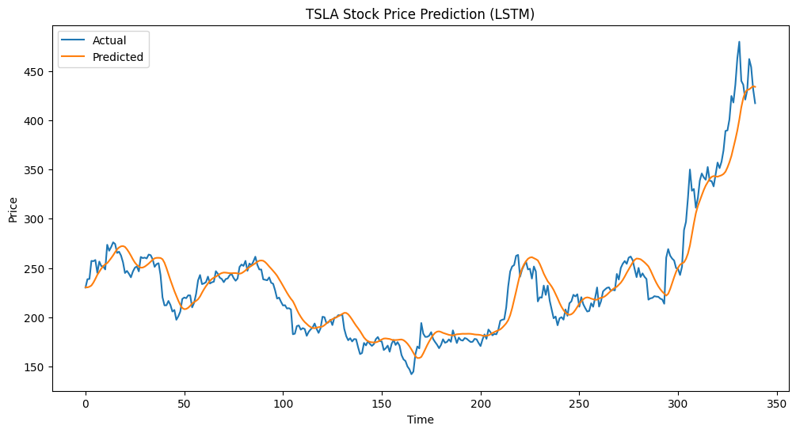
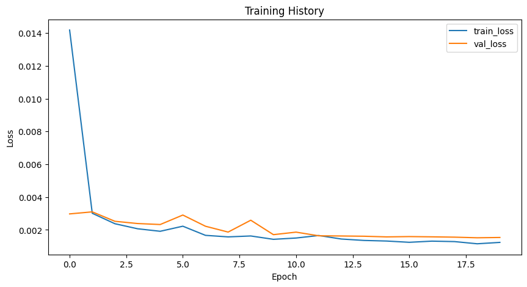

# Stock Price Prediction Using LSTM

A time-series forecasting project that compares traditional machine learning approaches with an LSTM neural network for next-day stock price prediction.

## Overview

The project uses historical TSLA stock data to predict next-day closing prices and compares three approaches:

- Naive baseline
- Linear Regression
- LSTM neural network

## Approach

```text
Historical Stock Data
        ↓
Data Preprocessing
        ↓
Feature Scaling
        ↓
Sequence Generation
        ↓
Model Training
   ↙       ↓       ↘
Naive   Linear    LSTM
        Regression
   ↘       ↓       ↙
     Model Evaluation
        ↓
Predicted Prices
```

## Results

| Model | RMSE |
|---|---:|
| Naive | 18.2 |
| Linear Regression | 12.5 |
| **LSTM** | **7.8** |

The LSTM model achieved the lowest RMSE among the three approaches.

## Technologies

- Python
- NumPy
- Pandas
- yfinance
- Scikit-learn
- TensorFlow / Keras
- Matplotlib

## Visualizations

### TSLA Closing Price


### Actual vs Predicted



### Training History



## Project Structure

```text
├── stock_price_prediction.ipynb
├── TSLA closing price.png
├── prediction.png
├── training_history.png
└── README.md
```

## Key Concepts

- Time-series forecasting
- LSTM neural networks
- Feature scaling
- Sequence generation
- Model benchmarking
- RMSE and MAPE evaluation
- Stock price visualization

> This project is for educational purposes and is not intended as financial advice.
